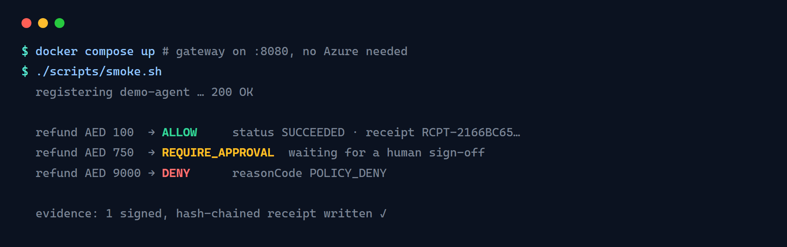
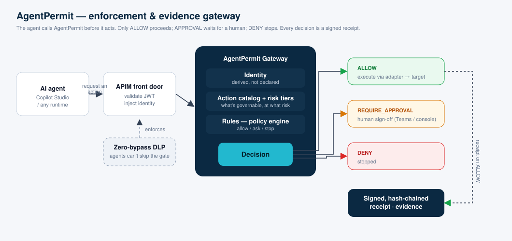

# AgentPermit

[](LICENSE)
[](https://dotnet.microsoft.com/)


**Every agent. Explicitly permitted.**

AgentPermit is an open-source **enforcement and evidence gateway** for AI agents. Wherever an agent
is about to do something real — issue a payment, grant access, release a record — it first calls
AgentPermit and gets back **ALLOW**, **REQUIRE_APPROVAL**, or **DENY**. It proceeds only on allow; on
approval a named human signs off; on deny it stops. Every decision is written to a signed,
tamper-evident receipt, and the agent never touches the target system except through the checkpoint.

Built for Microsoft Copilot Studio / Power Platform agents, but the gateway is a standalone service
you can call from any agent runtime.

> A governance product you can't inspect isn't trustworthy. This is the open core — audit the wall yourself.



## Architecture



The agent calls AgentPermit **before** it acts. The gateway decides from the **action catalog** (what's
governable, at what risk) and your **rules**, using an identity **derived from the authenticated caller**.
Only **ALLOW** proceeds (executing via an adapter and emitting a signed receipt); **REQUIRE_APPROVAL** waits
for a human; **DENY** stops. A **zero-bypass DLP** ensures agents can only reach targets through the gate.

## Why

- **Enforcement, not just observability** — it blocks/steps-up actions at a chokepoint, before they happen.
- **Tamper-evident evidence** — every decision is a hash-chained, signed receipt.
- **Derived identity** — the agent's identity comes from the authenticated caller, never a request body.
- **Zero-bypass** — paired with a data-loss policy so agents can only reach targets through AgentPermit.

## Requirements

- **To run the quickstart:** [Docker](https://docs.docker.com/get-docker/) (Desktop or Engine) with Compose.
- **To build from source:** [.NET 10 SDK](https://dotnet.microsoft.com/download) and [Node.js 20+](https://nodejs.org/) (for the console).
- **To govern Copilot Studio agents (production):** a Microsoft Power Platform / Copilot Studio environment,
  Azure API Management in front (JWT validation + identity injection), and an Entra app registration per agent.
  The gateway persists to Azure SQL when configured, and signs receipts with an Azure Key Vault key; without
  those it runs in-memory with unsigned receipts (fine for local/dev).

No external services are needed for the local quickstart — it runs fully standalone.

## Quickstart

Run the enforcement gateway standalone — in-memory storage, no Azure, no APIM:

```bash
docker compose up          # gateway → http://localhost:8080
```

Or run the scripted smoke test, which does everything below in one go:

```bash
./scripts/smoke.sh
```

**1. Register an agent** (agents must be known before they can act — secure by default):

```bash
curl -s -X PUT http://localhost:8080/api/admin/agents/demo-agent \
  -H 'X-Admin-Key: dev-admin-key' -H 'Content-Type: application/json' \
  -d '{"agentId":"demo-agent","displayName":"Demo Agent","enabled":true,"type":"Autonomous","riskTier":"Low"}'
```

**2. Drive decisions** against the seeded baseline refund policy. Note: `idempotencyKey` must be
caller-owned and **≥ 8 characters**; `Refund.Issue` requires `customerId`, `amount`, `currency` ("AED"), `reason`.

```bash
# Small refund → ALLOW (executes against the built-in simulator; returns a receipt)
curl -s http://localhost:8080/api/actions/request -H 'Content-Type: application/json' \
  -d '{"actionId":"Refund.Issue","agentId":"demo-agent","idempotencyKey":"demo-allow-01",
       "parameters":{"customerId":"CUST-1","amount":100,"currency":"AED","reason":"Damaged item"}}'
# → decision ALLOW, status SUCCEEDED, receiptNumber RCPT-…

# Mid refund → REQUIRE_APPROVAL (waits for a human sign-off)
curl -s http://localhost:8080/api/actions/request -H 'Content-Type: application/json' \
  -d '{"actionId":"Refund.Issue","agentId":"demo-agent","idempotencyKey":"demo-appr-01",
       "parameters":{"customerId":"CUST-1","amount":750,"currency":"AED","reason":"Late delivery"}}'
# → decision REQUIRE_APPROVAL

# Large refund over the limit → DENY
curl -s http://localhost:8080/api/actions/request -H 'Content-Type: application/json' \
  -d '{"actionId":"Refund.Issue","agentId":"demo-agent","idempotencyKey":"demo-deny-01",
       "parameters":{"customerId":"CUST-1","amount":9000,"currency":"AED","reason":"Fraud claim"}}'
# → decision DENY, reasonCode POLICY_DENY
```

Each response carries the `decision`, `reasonCode`, and (on ALLOW) a receipt. Admin APIs
(agents, rules, evidence) are under `/api/admin/*` with header `X-Admin-Key: dev-admin-key`.

To wire this into a Copilot Studio agent, see [`docs/COPILOT-STUDIO-RUNBOOK.md`](docs/COPILOT-STUDIO-RUNBOOK.md).

### The admin console

The console (`frontend/admin`) signs in with Microsoft Entra ID, so it needs an app registration.
Copy `frontend/admin/.env.example` → `.env.local`, fill in your Entra client id + API scope + the
gateway URL, then:

```bash
cd frontend/admin && npm install && npm run dev     # → http://localhost:5173
```

### Build & test from source

```bash
dotnet build backend/src/AgentPermit.Gateway
dotnet test  tests/AgentPermit.Gateway.Tests        # test suite should pass
cd frontend/admin && npm install && npm run build
```

## Use it with your own agent — in 4 steps

1. **Run the gateway** — `docker compose up` (standalone), or deploy it into your environment behind APIM.
2. **Register your agent** — bind it to a workload identity so the gateway can trust who's calling:
   `PUT /api/admin/agents/{agentId}`. Identity is derived from the authenticated caller, never a request body.
3. **Write a rule** — pick an action from the catalog and decide *allow / ask / stop*, with conditions
   (e.g. "Refund.Issue over 1,000 → ask for sign-off") and optionally scope it to specific agents.
4. **Add the checkpoint in your agent** — right before it does the real thing, call
   **AgentPermit → Request an action** (`actionId` + params + a caller-owned `idempotencyKey`). Continue
   only on **ALLOW**; on **REQUIRE_APPROVAL** wait for a human; on **DENY** stop. Keep the real action inside
   the ALLOW branch only — that's the wall. Pair it with a data-loss policy so agents can't bypass the gate.

Full Copilot Studio walkthrough: [`docs/COPILOT-STUDIO-RUNBOOK.md`](docs/COPILOT-STUDIO-RUNBOOK.md).

## How it works

```
agent → (about to act) → AgentPermit /api/actions/request
     → policy engine: rules + conditions + consequence tier
     → ALLOW | REQUIRE_APPROVAL | DENY  (+ signed receipt)
     → agent proceeds only on ALLOW (or after human approval)
```

- **Action catalog** (`config/catalog`) — the vocabulary of governable actions, by domain and risk tier.
- **Rules** — for an action + conditions, decide allow / ask / stop; attach to specific agents or all.
- **Connector** (`power-platform/connector`) — the Copilot Studio custom connector for "Request an action".

## Project layout

| Path | What |
|---|---|
| `backend/src/AgentPermit.Gateway` | The enforcement gateway + policy engine |
| `frontend/admin` | Admin console (React + Vite) |
| `power-platform/connector` | Copilot Studio custom connector definition |
| `config/catalog` | Action catalog (governable actions by domain) |
| `docs` | Architecture, action catalog, Copilot Studio runbook |
| `tests` | Gateway test suite |

## Open core

This is the Apache-2.0 open core. The hosted control plane / Fleet Ops, the signed-receipt
attestation service, and certified compliance policy packs are part of the commercial edition —
see [`OPEN-SOURCE.md`](OPEN-SOURCE.md) for the boundary.

## Contributing

See [`CONTRIBUTING.md`](CONTRIBUTING.md) (DCO sign-off required) and [`SECURITY.md`](SECURITY.md).
Please don't weaken the enforcement invariants — fix the integration instead.

## License

[Apache-2.0](LICENSE). "AgentPermit" and the AgentPermit logo are trademarks of AgentPermit.
